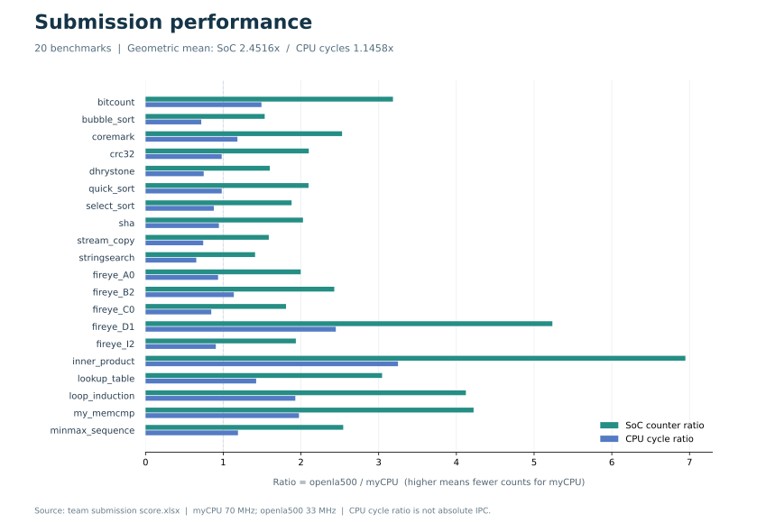

<p align="center">
  
</p>

<h1 align="center">驯龙高手 · LoongArch CPU</h1>

<p align="center">
  <strong>南开大学 · 2026 年全国大学生计算机系统能力大赛 CPU 设计赛（龙芯杯）</strong><br>
  双发射 · 八级弹性流水线 · FPGA 微系统
</p>

<p align="center">
  
</p>

<p align="center">
  <a href="#overview">项目简介</a> ·
  <a href="#architecture">整体架构</a> ·
  <a href="#features">实现特点</a> ·
  <a href="#results">测试结果</a> ·
  <a href="#getting-started">工程使用</a>
</p>

---

<a id="overview"></a>

## 项目简介

我们是南开大学参加 **2026 年“龙芯杯”CPU 设计赛**的**驯龙高手队**。本仓库保存了团队设计的 LoongArch CPU 核源码、FPGA SoC 工程，以及仿真、上板测试和时序分析工具。

处理器以 **LoongArch32 Reduced** 为目标指令集，从五级流水实现出发，逐步加入 Cache、TLB、分支预测与特权控制，并演进为**双发射、八级弹性流水线**。设计在资源约束下按程序顺序发射与提交，通过前递、停顿、指令保留和流水线取消处理相关性、访存等待与异常恢复。

当前默认分支为 `merge-timing-ipc-up`，包含双发射、IPC 优化与时序优化合并后的实现。最终参赛提交采用 `src/mycpu/` 目录，本仓库对应的 CPU 源码位于 **[`IP/myCPU/`](IP/myCPU/)**。

<a id="architecture"></a>

## 整体架构


八级划分将下一 PC 选择、预测与地址转换、取指握手、执行和数据请求分开。各级通过 `valid / ready_go / allow_in` 配合，在后级阻塞时保留当前指令，在重定向或异常发生时取消相应路径。

| 组成 | 设计 |
| :--- | :--- |
| 发射与提交 | 两个指令槽，slot0 为较老指令、slot1 为较年轻指令；按年龄顺序控制提交 |
| 执行与相关处理 | ALU、乘除法、多级前递、RAW/WAW 检查、资源仲裁与部分发射 |
| 分支预测 | 256 项 BTB、256 项 gshare BHT（两位饱和计数器）、16 项返回地址栈 RAS |
| 指令与数据 Cache | 分离式 I-Cache / D-Cache；各 32 KiB，2 路组相联、1024 组、16 B Cache Line |
| 地址转换 | 默认 16 项 TLB，配合 ASID、直接地址映射窗口和页式地址转换 |
| 特权与异常 | CSR、异常与中断、异常返回、TLB 管理、IDLE、LL/SC、屏障与 Cache 操作 |
| 总线与 SoC | SRAM-like 请求/响应接口，通过 AXI 桥连接外部存储；集成 DDR、UART 等外设 |
| FPGA 平台 | Xilinx Artix-7 `xc7a200tfbg676-2`，使用 Block RAM 与 Divider IP |

<a id="features"></a>

## 实现特点

### 双发射与顺序控制

双发射覆盖能够安全并行的路径。译码级检查两个槽位之间的数据相关与资源冲突，并区分暂时无法发射的年轻指令和必须取消的错误路径指令。暂时无法发射的指令保留在 hold 状态，避免因第一条指令推进而丢失第二条指令。特殊指令和访存由仲裁逻辑限制并行，数据请求接口仍共享使用。

写回级按照指令年龄处理异常和架构状态更新。当较老指令发生异常或执行需要改变控制流的系统操作时，限制较年轻槽位的提交，使寄存器、CSR 和异常状态保持一致。

源码入口：[decode.sv](IP/myCPU/decode.sv) · [EXE2.sv](IP/myCPU/EXE2.sv) · [WB.sv](IP/myCPU/WB.sv)

### 分支预测与取指恢复

前端结合 BTB、gshare BHT 和 RAS 预测分支方向、目标地址与返回地址。BHT 随指令保存查询时的全局历史快照，更新时使用相应索引。译码级解析实际分支结果后，结合指令是否发射决定预测器更新与重定向，前端处理旧请求返回和取消，避免错误路径数据继续进入流水线。

源码入口：[Pre_IF1.sv](IP/myCPU/Pre_IF1.sv) · [Pre_IF2.sv](IP/myCPU/Pre_IF2.sv) · [bht.sv](IP/myCPU/bht.sv) · [btb.sv](IP/myCPU/btb.sv) · [ras.sv](IP/myCPU/ras.sv)

### 存储层次与特权指令

I/D Cache 通过 SRAM-like 接口与核心连接，处理命中、缺失、替换和重填，并由 AXI 桥完成外部访问。TLB 与 CSR 共同管理地址转换和权限状态；LL/SC、IDLE、异常和屏障操作则与有效槽位、流水线推进及取消控制配合，约束相关副作用的生效时机。

源码入口：[icache.sv](IP/myCPU/icache.sv) · [cache.sv](IP/myCPU/cache.sv) · [tlb.sv](IP/myCPU/tlb.sv) · [csr_regfile.sv](IP/myCPU/csr_regfile.sv) · [bridge_SRAM_AXI.sv](IP/myCPU/bridge_SRAM_AXI.sv)

### 时序分析与实现优化

工程使用 Tcl 导出 Vivado 时序路径，再用 Python 整理起止点、Slack、逻辑/布线延迟、逻辑级数与扇出，输出 Markdown 和 CSV，帮助定位流水级负载和跨模块长路径。优化围绕流水级拆分、Cache 命中通路，以及前递和控制信号的组合路径展开。

最终提交版还对 D-Cache 命中数据选择和 RAS 返回地址选择进行了调整，以减少控制信号进入数据路径的影响。这两处与 GitHub 当前版存在差异，详见[提交版本说明](docs/results/submission-results.md#版本对应关系)。

工具入口：[analyze_timing_full.py](mytool/analyze_timing_full.py) · [时序报告导出与分析](mytool/2.时序报告导出与分析.md)

<a id="results"></a>

## 测试结果

以下数据来自团队提供的最终提交材料，按打分表中的原始计数重新计算。性能测试 CPU 时钟配置为 **70 MHz**，对比基线为打分表中的 **openla500**。

| 功能测试 | CPU 时钟配置 | 系统计数器比值 | CPU 周期比值 |
| :---: | :---: | :---: | :---: |
| **58 / 58 · 100 分** | **70 MHz** | **2.4516×** | **1.1458×** |

系统计数器比值与 CPU 周期比值均为 **20 项测试的几何平均值**，分子为 openla500、分母为本设计。前者反映相同系统计数时钟下的运行时间比，后者比较 CPU 周期消耗；**1.1458 是周期比值，不是绝对 IPC**。基线 CPU 频率为 33 MHz，与本设计不同。

测试覆盖 bitcount、排序、CoreMark、Dhrystone、CRC32、SHA、流式复制、字符串搜索、内积等程序。系统测试栏填报为“成功启动 Linux，并运行 `ls`”。具体记录与计算口径见[提交结果说明](docs/results/submission-results.md)。

<details>
<summary><strong>查看 20 项性能测试对比</strong></summary>

<p align="center">
  
</p>

完整原始计数与逐项比值见[提交结果说明](docs/results/submission-results.md#逐项性能数据)。

</details>

<details>
<summary><strong>版本与验证范围</strong></summary>

最终提交材料与当前 GitHub 默认分支的 CPU 源码，仅 `cache.sv` 和 `decode.sv` 两个文件存在内容差异，其余核对的 `.sv`、`.vh`、`.xci` 文件在忽略换行格式后相同。上面的成绩属于提交材料记录，不能直接视为 GitHub 当前版重新测试的结果。

仓库中原有的 [perf_vio.csv](fpga/nscscc-team/run_vivado/result/perf_vio.csv) 与 [perf_vio_runs.csv](fpga/nscscc-team/run_vivado/result/perf_vio_runs.csv) 是 2026-08-04 引入的历史记录，早于后续双发射改造。已有实现时序报告也包含历史结果和多个时钟域；CPU 频率应以对应版本的 `cpu_clk` 配置与实现报告核对。

</details>

<a id="getting-started"></a>

## 工程使用

```text
IP/myCPU/                         CPU 核、Cache、TLB、预测器与 CPU IP 配置
chip/soc_demo/nscscc-team/         SoC、DDR 与外设集成
fpga/nscscc-team/                 Vivado 工程脚本、约束、仿真与上板测试
software/examples/                功能与性能测试二进制
mytool/                           时序分析、RTL 排版与注释字符集工具
docs/                             README 配图与提交结果说明
```

阅读代码建议从 [mycpu_core.sv](IP/myCPU/mycpu_core.sv) 的整体连接开始，再按流水级查看译码、执行、访存与写回。完整 FPGA 流程依赖 Vivado 和相关 IP；已有工程日志使用 **Vivado 2023.2**。Python 时序分析工具只依赖标准库。

<details>
<summary><strong>获取源码与创建工程</strong></summary>

```bash
git clone --branch merge-timing-ipc-up https://github.com/ghub1821239/NSCSCC2026-NKU-LLongarch.git
cd NSCSCC2026-NKU-LLongarch/fpga/nscscc-team/run_vivado
vivado -mode batch -source create_project.tcl
```

在上述目录运行脚本。生成工程为 `project/loongson.xpr`，综合顶层为 `soc_top`，仿真顶层为 `tb_top`。[create_project.tcl](fpga/nscscc-team/run_vivado/create_project.tcl) 会清理并重建 `project/` 和部分 IP 生成目录，已有结果应先保存。

</details>

<details>
<summary><strong>仿真、实现与上板入口</strong></summary>

| 流程 | 入口 |
| :--- | :--- |
| 功能仿真 | [mycpu_tb.sv](fpga/nscscc-team/testbench/mycpu_tb.sv)、[run_func_test.tcl](fpga/nscscc-team/run_vivado/run_func_test.tcl) |
| 批量性能仿真 | [run_allbench.tcl](fpga/nscscc-team/run_vivado/run_allbench.tcl) |
| 综合、实现与时钟检查 | [bit.tcl](fpga/nscscc-team/run_vivado/bit.tcl) |
| JTAG/VIO 测试采集 | [vio.tcl](fpga/nscscc-team/run_vivado/vio.tcl)、[jtag_axi_master.tcl](fpga/nscscc-team/run_vivado/jtag_axi_master.tcl) |

使用前核对工作目录、测试镜像及板卡配置。JTAG 下载脚本当前固定加载性能 `allbench` 镜像，功能测试需切换到对应镜像；[PowerShell 入口](mytool/run_vivado_vio.ps1) 中的本机路径也需要调整。实现脚本对负 Slack 输出警告，需查看报告确认 setup/hold 时序。

</details>

<details>
<summary><strong>导出与分析时序路径</strong></summary>

在 Vivado 中打开实现，并进入报告目录后导出路径：

```tcl
open_run impl_1
report_timing -setup -max_paths 2000 -nworst 2000 \
    -path_type full -file all_paths_latest.rpt
report_timing_summary -setup -hold -file timing_summary_latest.rpt
```

在仓库根目录运行，将实际报告目录传给 `--input`：

```bash
python mytool/analyze_timing_full.py \
  --input fpga/nscscc-team/run_vivado/result/for_timing_report \
  --output fpga/nscscc-team/run_vivado/result/for_timing_report \
  --cpu-only
```

工具输出 `timing_paths.csv` 和 `timing_summary.md`。重复生成会覆盖同名汇总，比较不同实现前应保留旧结果。`--cpu-only` 筛选 CPU 层次相关路径，实际 CPU 频率仍需核对 `cpu_clk`。

</details>

## 团队

**南开大学 · 驯龙高手队**

设计以《CPU 设计实战：LoongArch 版》的处理器设计方法和基础实验框架为学习起点，结合比赛提供的 Chiplab 环境完成扩展与优化。SoC、外设和测试基础设施沿用龙芯杯相关工程，并使用 Xilinx Block RAM 与 Divider IP。第三方代码的版权与许可按各文件中的声明保留。
